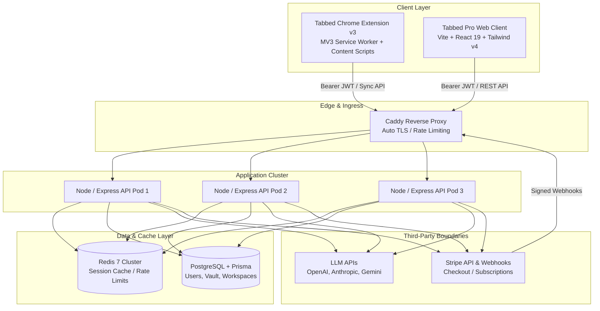

# Tabbed Pro — Production Architecture Specification

**Target Scale:** 10,000+ Active Users  
**Launch Window:** 14-Day Controlled Rollout  
**Status:** Pre-Launch Hardening

---

## 1. System Architecture Diagram



---

## 2. Component Inventory & Technical Stack

| Component                | Technology                                    | File Location                     | Responsibility                                                                                                                        |
| :----------------------- | :-------------------------------------------- | :-------------------------------- | :------------------------------------------------------------------------------------------------------------------------------------ |
| **Web Frontend**         | Vite 8, React 19, Tailwind v4, React Router 7 | `src/`                            | SPA for prompt composer, analytics, prompt vault, teams & billing settings.                                                           |
| **Local Storage Engine** | Browser LocalStorage                          | `src/lib/db.ts`                   | Offline prompt persistence, zero-latency local caching.                                                                               |
| **Unified API Client**   | Fetch Abstraction                             | `src/lib/api-client.ts`           | Handles API calls with fallback to local DB engine.                                                                                   |
| **API Server**           | Express.js, TypeScript                        | `src/server/server.ts`            | REST API, SSE streaming, rate limiting, request logging.                                                                              |
| **Database & ORM**       | PostgreSQL, Prisma ORM                        | `prisma/schema.prisma`            | 9 models: `User`, `AIProfile`, `Prompt`, `PromptScore`, `PromptInsight`, `Folder`, `Template`, `Workspace`, `WorkspaceMember`.        |
| **Auth Middleware**      | JWT Bearer Token                              | `src/server/auth-middleware.ts`   | Validates session tokens, extracts `userId` and authorization scopes.                                                                 |
| **Billing Integration**  | Stripe SDK (v2025-02-24)                      | `src/server/stripe.ts`            | Checkout sessions, billing portal, HMAC signature webhook verification.                                                               |
| **AI LLM Engine**        | Multi-Provider Adapters                       | `src/server/llm/`                 | OpenAI (`gpt-4o`), Anthropic (`claude-3-5-sonnet`), Gemini (`gemini-1.5-flash`), local Ollama (`localhost:11434`), and mock fallback. |
| **Deployment Pods**      | Docker, Caddy, Redis                          | `docker-compose.yml`, `Caddyfile` | 3 stateless Express replicas, Caddy edge reverse proxy, Redis 7 LRU cache.                                                            |

---

## 3. Trust Boundaries & Security Rules

### Boundary 1: Extension Client to Backend API

- **Rule:** Extension is an **untrusted client**. Extension local storage can be manipulated by users or malicious scripts.
- **Enforcement:**
  - Client never asserts `isPro: true` or subscription tier.
  - Server extracts `userId` solely from verified cryptographically signed JWT.
  - All prompt sync requests validate ownership (`where: { id: promptId, userId }`).

### Boundary 2: Stripe Billing Webhook to Backend

- **Rule:** Webhook requests originate outside the private VPC.
- **Enforcement:**
  - Signature verification (`stripe.webhooks.constructEvent`) executed against raw body buffer (`express.raw({ type: "application/json" })`).
  - Idempotency recorded in Redis / database to prevent duplicate credits from replayed webhooks.

### Boundary 3: Backend to LLM Providers

- **Rule:** Sensitive user prompt data leaves the system to third-party model providers.
- **Enforcement:**
  - API keys stored in server environment variables only (`OPENAI_API_KEY`, `ANTHROPIC_API_KEY`, `GEMINI_API_KEY`).
  - System prompts sanitize prompt payload to prevent prompt injection and unauthorized instruction execution.
  - No prompt data stored by providers for model training (Enterprise zero-retention compliance).

---

## 4. Cloud Synchronization Design

```text
[Extension / Local DB]                [Backend API]                    [PostgreSQL]
        |                                   |                                |
1. Queue changes in Outbox                  |                                |
2. Send Batch (id, version, payload) ------>|                                |
                                     3. Verify JWT & Ownership               |
                                     4. Optimistic Concurrency Check ------->|
                                        - If server_ver == client_ver: OK    |
                                        - If server_ver > client_ver: 409    |
5. Accept OK or Resolve Conflict <----------|                                |
6. Update local version cursor              |                                |
```

### Sync Contract & Fields

Every syncable entity (`Prompt`, `Folder`, `Template`) conforms to:

- `id`: Stable client-generated CUID / UUID (`pmt_...`).
- `userId`: Authoritative user ID from JWT session.
- `version`: Monotonically increasing integer incremented on every mutation.
- `updatedAt`: ISO 8601 server timestamp.
- `isArchived` / `deletedAt`: Tombstone indicator to prevent resurrection of deleted prompts.
- `payload`: JSON payload of prompt content, score, and tags.

---

## 5. Capacity & Scalability Calculations (10,000 Users)

$$\text{Daily Active Users (DAU)} = 10,000 \times 0.40 = 4,000\text{ active/day}$$
$$\text{Average Operations per User} = 30\text{ sync/eval requests/day}$$
$$\text{Total Daily Requests} = 4,000 \times 30 = 120,000\text{ requests/day}$$
$$\text{Average Rate} = \frac{120,000}{86,400} \approx 1.39\text{ req/sec}$$
$$\text{Peak Hour Load (3x multiplier)} \approx 15\text{–}25\text{ req/sec}$$

### Ingress & Node Sizing

- **Caddy:** Handles > 5,000 req/sec comfortably.
- **Node Replicas:** 3 container instances handle up to 300 req/sec total.
- **PostgreSQL Connection Pool:** Max connections capped at 50 with Prisma pool timeout of 10s.
- **Redis Cache:** Maxmemory 256MB LRU policy protects against OOM.
